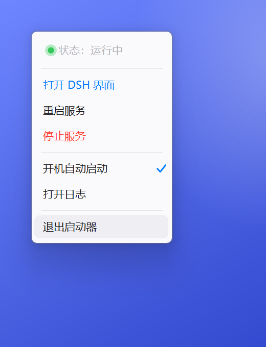
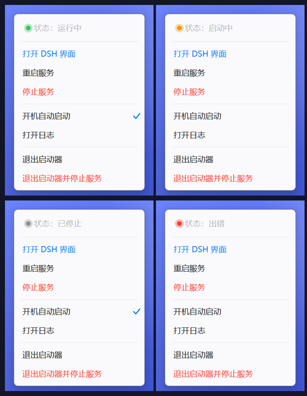
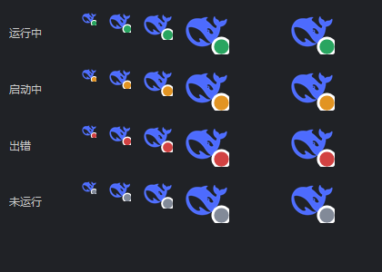

# DSH Web 一键启动器

给 [`dsh web`](https://www.npmjs.com/package/@deepseek-ai/dsh) 用的 Windows 托盘启动器：
**双击就起服务、自动打开带 token 的页面，全程没有任何黑色命令行窗口。**



| 菜单的四种状态 | 托盘图标（16 / 24 / 32 / 48px） |
| --- | --- |
|  |  |

## 为什么会有这个项目

`dsh web` 本身只能用终端敲，日常用下来有三件事很烦：

1. 每次都要开一个 CMD / PowerShell 窗口，**窗口一关服务就没了**；
2. 地址里带一次性 token，**每次启动都会变**，收藏和手敲都不行；
3. 想看输出、停服务、重启服务，只能回去翻那个窗口。

所以有了这个 exe：常驻托盘，双击起服务并直接打开「当前能用」的页面，
右键可以停止、重启、看日志、设开机自启，托盘小圆点实时显示服务状态。

## 快速开始

**方式一（推荐，不用装任何东西）**：下载 [`dist/DSH-Web-Launcher-portable-v1.4.zip`](dist/DSH-Web-Launcher-portable-v1.4.zip)
解压到任意固定目录，双击 `DshLauncher.exe`。第一次可能被 SmartScreen 拦，点「更多信息 → 仍要运行」。

**方式二（自己编译）**：装好 .NET Framework 4 自带的 `csc.exe`（Win10/11 自带），
然后跑 `rebuild.ps1`（见下面「自己重新编译」）。

**前提**：这台机器上得能用命令行跑 `dsh web`（`npm i -g @deepseek-ai/dsh`）。
只有桌面客户端、没有 `dsh` 命令的机器用不了——启动器干的就是替你敲这行命令。

## 怎么用

| 场景 | 操作 |
| --- | --- |
| 平时启动 | 双击桌面 **「DSH Web」** 图标（开始菜单里也有） |
| 再次双击 | 不会多开；只是把浏览器页面再打开一次 |
| 查看状态 | 右下角托盘找**蓝色小鲸鱼**，右下角的小圆点就是当前状态（绿＝运行中／橙＝启动中／红＝出错／灰＝未运行） |
| 打开界面 | 双击托盘图标，或右键 → 打开 DSH 界面 |
| 重启服务 | 右键托盘 → 重启服务 |
| 停止服务 | 右键托盘 → 停止服务 |
| 看输出 | 右键托盘 → 打开日志（`%LOCALAPPDATA%\DshLauncher\dsh-web.log`：dsh web 的控制台输出） |
| 开机自启 | 右键托盘 → 勾选「开机自动启动」（写 HKCU Run 项，`--silent` 静默模式） |

右键菜单是自绘的 iOS 风格：圆角、悬浮胶囊、蓝色主操作、红色危险操作，
并且**按鼠标所在显示器自动缩放**（100% / 125% / 150% / 200% 都按真实像素重排，不会发虚）。

菜单的版式约定（改之前先看 `DshMenu.cs` 里 `Ios` 和 `IosMenu` 的注释）：

- 状态行永远在最上面，**左边一颗彩色球跟状态一一对应**：
  运行中＝绿、启动中＝橙、启动失败＝红、未运行＝灰（`MenuSpec.SetStatus(文字, 颜色)` 一处改，球和字一起变）。
- 状态行和条目**同一号字**（13.5px × 缩放），层级只靠颜色区分，不靠缩字号。
- 左右内边距 `16px × 缩放`、上下 `7px × 缩放`；对勾预留 `20px × 缩放`，打勾不顶字。
- **留白只有一个变量** `sepV = 3px × 缩放`：分割线上下、菜单上下边框都用它。
  分割线自身会占掉约 5px，所以首尾两条透明占位条目（`Tag="spacer"`）高度取 `sepV + 2px × 缩放`，
  这样「边框→胶囊」和「胶囊→分割线」在像素上对齐（150% 实测 8 / 9 / 9）。
- 上下边框留白**必须**用占位条目撑：`ToolStripDropDownMenu` 会把 `Menu.Padding` 吃掉
  （实测改成 16px 菜单尺寸一个像素都不变），最后一条否则会贴着底边。
- 条目文字全部自己用 `TextRenderer` 画：`ToolStripItem.Padding` 在「关掉图片栏 + 强制等宽」时是不生效的，别指望它做缩进。
- 关掉左侧图片栏（`ShowImageMargin = false`），否则会平白多出 25px 空白。

想单独看菜单长得对不对：`tools\MenuPreview.exe 1.5`（第一个参数是缩放倍数），
`tools\MenuPreview.exe 1.5 start` / `stop` / `err` 可切换状态球颜色核对，末尾加 `hover` 看悬浮胶囊。
最新设计图：`docs\menu-final.png`（150% 悬停态）、`docs\menu-states.png`（四种状态对照）。

启动器自己随时退出都行（右键 → 退出启动器），**它不会再关掉已经跑起来的 dsh web**。

## 图标

- 快捷方式和 exe 的图标是 DeepSeek 小鲸鱼（`dsh.ico`，16/20/24/32/40/48/64 用 DIB 条目、128/256 用 PNG 条目）。
- 托盘图标是**鲸鱼 + 右下角状态点**，点色跟着状态走（`MakeIcon(状态色)`，白圈描边保证在深色任务栏上也分得清）。四态对照图：`docs\icon-states.png`。
- 想换图标：把新的 SVG 放到临时目录，用 Edge 无头模式渲染成 256×256 PNG
  （`msedge --headless=new --default-background-color=00000000 --screenshot=logo256.png --window-size=256,256 页面.html`），
  覆盖 `logo256.png` 后跑 `tools\MakeIco.exe logo256.png dsh.ico`，再 `rebuild.ps1`。
  鲸鱼本体是编译进 exe 的资源（`/resource:logo256.png,DshLogo.png`），换图要重新编译。
- 图标预览：`tools\IconPreview.exe docs\icon-states.png`（内部直接反射调用 `Launcher.MakeIcon`，保证和运行时同一套代码）。

## 它到底干了什么

1. 探测 `127.0.0.1:3080`（TCP 连接测试，毫秒级）。
2. 端口已通 → 只是打开浏览器，**绝不再拉起第二个 dsh web**。
3. 端口不通 → 用隐藏的控制台跑
   `node "…\@deepseek-ai\dsh\lib\bin.js" web --port 3080 --no-open`
   （`--no-open` 是关键：不让 dsh 自己再弹一次浏览器），轮询到端口就绪后再打开页面。
4. 托盘图标颜色就是状态：灰=未运行，橙=启动中，绿=运行中，红=启动失败。

## 关于 token（吃一堑长一智）

dsh web 现在只认**带 token 的地址**，直接开 `http://127.0.0.1:3080/` 会看到
「dsh web authentication required; reopen the URL printed by dsh web」。

- 宿主启动时会把带 token 的地址打印出来，落到 `dsh-web.log`，形如
  `dsh web: http://127.0.0.1:3080/?token=xxxxxxxx`
- 启动器每次打开页面前都从这份日志里取**最后一条**带 token 的地址，所以**重启服务后 token 变了也照样能进**。
- 读这份日志必须用 `FileShare.ReadWrite` 打开——宿主一直占着它在写，普通读法会报“文件正被另一进程使用”。
- **唯一例外**：如果你自己在终端里敲 `dsh web` 起服务，启动器读不到那份日志，就只能开裸地址（会 401）。这种情况请直接把终端里打印的地址复制到浏览器。

## 自己改端口 / 路径

**这些都不用重新编译**——改安装目录里的 `launcher.ini`，重启启动器即生效：

| 配置项 | 说明 |
| --- | --- |
| `port=` | 网页端口（默认 3080）；被占用时改成 3081 之类 |
| `workdir=` | dsh web 的工作目录；留空 = 文档\DSH_Workspace（自动创建） |
| `dsh=` | dsh 命令完整路径；留空 = 自动在 PATH 里找 `dsh.cmd` |
| `node=` / `bin=` | 只有自动探测失败时才需要填 |
| `--port=8080` | 临时试用，命令行直接带参数（优先级最高） |

- 重新编译请**只用** `rebuild.ps1`（它负责编译 → 打 Medium 标签 → 重装 → 静默重启）：

  ```powershell
  powershell.exe -NoProfile -ExecutionPolicy Bypass -File ".\rebuild.ps1"
  ```

  三条不能犯的规矩：
  1. **必须带 `-ExecutionPolicy Bypass`**，否则执行策略拦 `.ps1`。
  2. **手动编译的参数别自己手敲**：要一起编 `DshMenu.cs`，还要 `/win32manifest:app.manifest`
     和 `/resource:logo256.png,DshLogo.png`（少了 manifest 菜单又变糊，少了资源图标退回蓝底白 D）。
  3. **`rebuild.ps1` 必须存成「UTF-8 带 BOM」**：PowerShell 5.1 对无 BOM 的 UTF-8 按 ANSI 解析，
     里面的中文注释会把脚本切坏，报 `Set-Content: 参数 Path 为 null` 这种完全不搭界的错。改完脚本记得补 BOM。

## 日志

- `%LOCALAPPDATA%\DshLauncher\launcher.log`：启动器自己的动作记录（UTF-8，超过 1 MB 自动重开）。
- `%LOCALAPPDATA%\DshLauncher\dsh-web.log`：dsh web 的输出（等价于你在终端里看到的那些行）。启动失败先看这个，**带 token 的地址在最后一行**。
- `%LOCALAPPDATA%\DshLauncher\url.txt`：最近一次带 token 的地址（日志被清掉也能开对页面）。

## 发给别人用（便携版）

`dist\DSH-Web-Launcher-portable-v1.4.zip`（54 KB）解压即用，里面只有 4 个文件：

| 文件 | 说明 |
| --- | --- |
| `DshLauncher.exe` | 启动器本体 |
| `launcher.ini` | 配置：端口 / 工作目录 / dsh 路径，留空就自动探测 |
| `使用说明.txt` | 给对方的说明（含第一次被 SmartScreen 拦怎么点） |
| `diagnose.cmd` | 出问题双击它，生成 `diagnose.txt`（dsh/node 位置、端口占用、当前配置） |

对方那台机器的前提：**装过 DSH 的命令行**（终端里 `dsh --version` 有输出）。
只装了桌面客户端、没有 `dsh` 命令的，这个启动器帮不上忙——它干的就是代替你敲 `dsh web`。

启动器现在按这个顺序找 dsh，几乎不需要配置：

1. `launcher.ini` 里的 `dsh=`；
2. 环境变量 `DSH_CMD`；
3. PATH 里的 `dsh.cmd` / `dsh.exe` / `dsh.bat`（npm 全局装完就有了）；
4. 都不行再退回 `node + bin.js`（路径同上，可从 `npm root -g` 推断）。

找不到就给一句人话提示，不会闷着不动。换端口直接改 `launcher.ini` 的 `port=`，不用重新编译。

## 已知提示

- 第一次运行新编译的 exe 可能被 SmartScreen 拦（未签名）：点「仍要运行」。**每次重新编译后 hash 变了，可能再弹一次**。
- **用户名或安装路径带中文**：1.3 及更早版本会在日志里报「系统找不到指定的路径 / The system cannot find the path specified」。
  原因是生成的 `start-dsh-web.cmd` 用系统 ANSI（GBK）写入，脚本里却又切了 `chcp 65001`，cmd 按 UTF-8 去解 GBK 的中文路径直接崩。
  1.4 起：脚本里不再切代码页，并把路径尽量换成纯 ASCII 的 8.3 短名；短名不可用的卷上靠 ANSI 兜底，两种都验过。
- 「停止服务 / 重启服务」会断开正在对话的页面，刷新即可。
- 源码目录里编译出来的 `DshLauncher.exe` 带低完整性标签（从 DSH 会话里写出的文件都是这样），**直接双击不会有托盘图标**；请用 `rebuild.ps1` 装到 `%LOCALAPPDATA%\Programs\DshLauncher\` 后跑那一份。
- 如果浏览器弹「Microsoft Edge 未响应，因为现有实例正在以提升的权限运行」：
  说明**已经开着的那份 Edge 是被管理员权限启动的**（早前按管理员身份跑过旧脚本会留下这种实例）。
  点一次 **「是(Y)」** 让 Edge 以普通权限重启，之后就不会再出现。启动器现在通过 `explorer.exe` 打开网址，保证以普通权限交给浏览器。

## 目录里其它东西

- `DshLauncher.cs`：主程序（托盘、启停、探测端口、取 token、开页面、图标合成）。
- `DshMenu.cs`：托盘菜单的自绘实现（iOS 风格 + DPI 缩放），单独编译。
- `app.manifest` / `logo256.png` / `dsh.ico`：DPI 声明、鲸鱼标源图、多尺寸图标。
- `launcher.ini`：运行期配置（端口 / 工作目录 / dsh 路径）；安装目录里那份生效，本目录这份是模板。
- `dist\`：便携版成品（文件夹 + zip），**发给别人用这个**。
- `docs\`：3 张图（菜单定妆照、四种状态、图标四态），全部由 `tools\MenuPreview.exe` 在纯色背景上生成，不含任何桌面内容。
- `tools\`：`MenuPreview`（预览菜单）、`MakeIco`（PNG→ICO）、`IconPreview`（渲染图标四态）。
- `rebuild.ps1`：编译 → 打 Medium 标签 → 重装 → 静默重启，一条命令搞定。
- `PROJECT-REPORT.md`：**项目报告**——排障全过程、每个 bug 的根因、验证数据、维护手册、剩余风险。
- 旧的 VBS / cmd / ps1 方案（原 `vbs-legacy\`）已于 2026-10-27 清理删除，取舍记录在项目报告 §4、§6。

## 许可

MIT，见 [LICENSE](LICENSE)。图标是 DeepSeek 的鲸鱼标，仅用于识别 DSH 官方产品，版权归 DeepSeek 所有。
